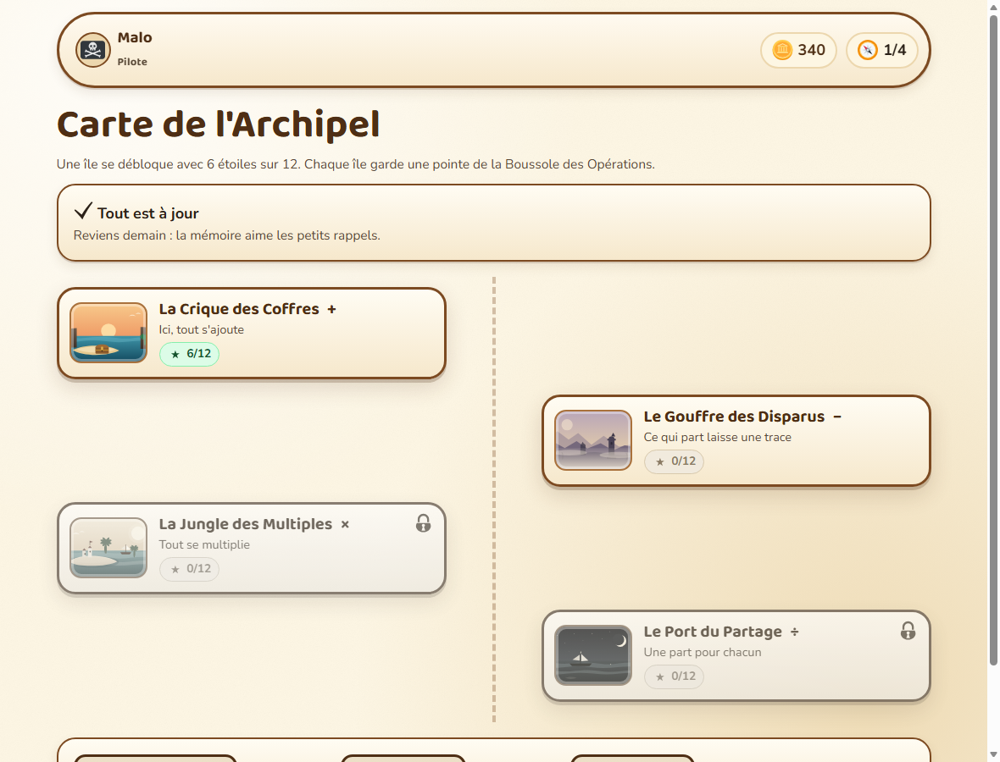
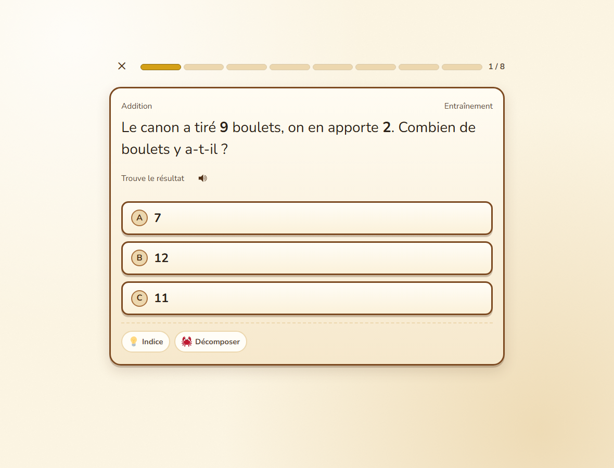
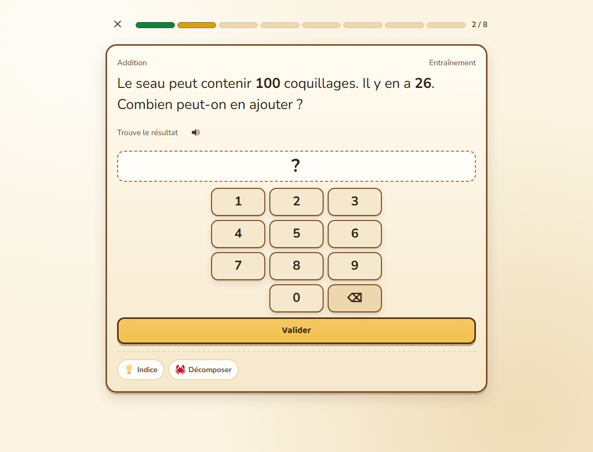
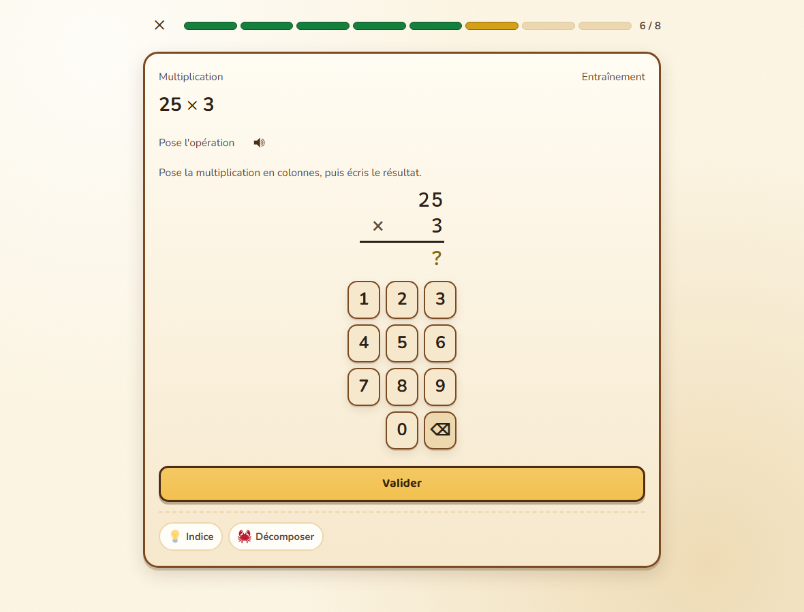
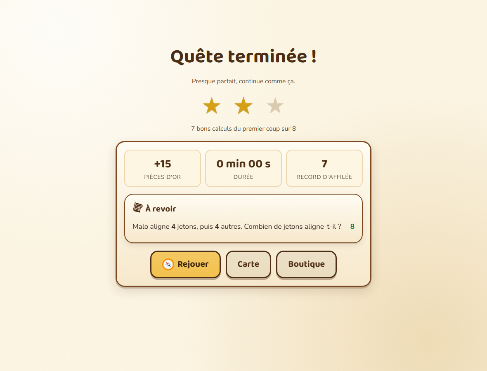

# L'Archipel des Calculs

**Un jeu de calcul mental pour le CM1 (10 ans), à jouer dans le navigateur, sans compte, sans
publicité et sans connexion.**

Traverse les quatre îles, bats leurs Gardiens et rassemble les quatre pointes de la
Boussole des Opérations : addition, soustraction, multiplication, division.

**En ligne : <https://brunothesatellite.github.io/aventure-calcul/>**

> **État du projet : contenu complet.** Le jeu est jouable de bout en bout : quêtes de
> 8 questions, QCM, pavé numérique, calcul posé, division avec reste, étoiles, or,
> répétition espacée, boutique et espace parent. **160 énoncés, 480 formulations.**






## Lancer le jeu

1. Ouvrez le dossier et **double-cliquez sur `index.html`**.
2. C'est tout. Aucune installation, aucun serveur, aucune connexion : le jeu fonctionne en
   `file://` dans Edge, Chrome ou Firefox.
3. La progression est enregistrée dans le navigateur (`localStorage`), sur cet appareil uniquement.

## Comment se passe une quête

Une quête = **8 questions** : deux révisions espacées, des questions du niveau, un rappel des
niveaux déjà traversés de la même île, et un défi qui mélange les opérations déjà travaillées.

**Pas de répétition** : chaque énoncé existe en **trois formulations** (même calcul, autre
histoire), le moteur en choisit une différente à chaque passage, et les niveaux précédents
reviennent en rappel. Une quête de niveau 1 affiche ainsi 8 formulations distinctes.

| Niveaux | Forme de la réponse |
|---|---|
| 1 et 2 | **QCM 3 choix**, avec des leurres fabriqués à partir d'erreurs réelles (retenue oubliée, table voisine, chiffres inversés…) |
| 3 et 4 | **Pavé numérique** : l'enfant écrit le résultat |
| gabarits « posé » | **Calcul en colonnes** : des bulles au-dessus des chiffres permettent d'écrire les reports, et le résultat se saisit **de droite à gauche**, comme on calcule |
| division euclidienne | **Deux cases** : quotient et reste |

Sur un calcul posé, l'enfant peut écrire ses reports comme sur un cahier : une bulle au-dessus
du chiffre concerné, en addition comme en soustraction. En soustraction, la méthode est celle de
l'école (par compensation) : un **1** au-dessus du chiffre du haut (+10) et un **+1** au-dessus
du chiffre du bas (+1).

Les principes anti-frustration :

- **L'erreur ne coûte rien.** Deux essais, puis la réponse est révélée et le calcul décomposé.
- **Les étoiles ne se perdent jamais** : 1 ★ pour avoir terminé, 2 ★ à 7/8 du premier coup,
  3 ★ à 8/8 sans aide.
- **Pas de chronomètre, pas de classement, pas de vies.**
- **Trois familiers** aident (décomposer, éliminer un choix, rappeler l'astuce), une fois par quête.



## Le principe : des énoncés paramétrés, pas des questions préchargées

Un énoncé n'est pas une phrase figée, c'est un **gabarit** :

```js
{
  id: "add-biscuits-02",
  ile: "addition",
  niveau: 2,
  competence: "add.retenue",
  nombres: { a: { min: 24, max: 58 }, b: { min: 17, max: 39 } },
  contraintes: ["a + b <= 100", "retenues(a, b) == 1"],
  enonce: "Le cuisinier range {a} biscuits dans un coffre et {b} dans un autre. Combien de biscuits a-t-il rangés en tout ?",
  operation: "+",
  reponse: "a + b",
  lecon: "retenue"
}
```

À chaque quête, `engine/generateur.js` tire les nombres, **vérifie les contraintes** et produit
le texte final. Une contrainte n'est pas un vœu : `retenues(a, b) == 1` interdit réellement les
tirages à deux retenues, ceux qu'un enfant de 10 ans ne peut pas faire de tête.

Conséquence pédagogique : la répétition espacée ne porte plus sur des questions mais sur des
**compétences** (`add.retenue`, `mul.table-7`, `div.reste`), qui ne s'épuisent jamais.

## Ce qui fonctionne aujourd'hui

| Écran | État |
|---|---|
| Accueil, choix du joueur, profils multiples, corbeille | ✅ |
| Carte de l'archipel, 4 îles, déblocage à 6 ★/12 | ✅ |
| Hub d'île, 4 niveaux, Gardien | ✅ |
| Quête : QCM, pavé, calcul posé, **division posée en potence** | ✅ |
| **Division posée (potence)** : quotient, produits et différences, chiffres descendus | ✅ niveaux 3 et 4 de l'île Division |
| **Salle des tables** : 9 tables + mixte, record, 5 pièces si 10/10 | ✅ |
| **Carte de chaleur** : étoiles île × niveau, erreurs par famille, compétences fragiles | ✅ espace parent |
| Étoiles, or, série, répétition espacée, révision du jour | ✅ |
| Boutique (3 familiers, 20 déguisements, récompenses réelles) | ✅ |
| Carnet de bord, badges, carnet de stratégies, journal | ✅ |
| Espace parent : PIN, export/import, récompenses, **tout débloquer** | ✅ |
| Réglages : sons, **choix de la voix**, **vitesse de lecture**, taille du texte | ✅ |
| Atelier des énoncés (outil de contrôle, dans l'espace parent) | ✅ |
| 160 énoncés (40 par île, 3 formulations chacun) | ✅ 480 formulations |

## Mode test (espace parent)

Sur la carte, **maintenez le cadenas « Parents » appuyé 1,2 seconde**. Le code à 4 chiffres est
créé au premier accès.

La carte **« Outils de test »** propose **« Tout débloquer »** : toutes les îles et tous les
niveaux passent à 2 ★, le temps d'essayer librement. La progression réelle est **mise de côté**
et se restaure d'un clic (« Revenir à la progression réelle »).

## Vérifier le contenu

```bash
node tools/lint-enonces.js
```

Le linter charge tout le contenu dans un contexte isolé, puis **tire 500 fois chaque énoncé**
et vérifie : réponse entière et positive, bornes respectées, aucun nombre qui trahit la réponse,
pluriels corrects, symboles isolés, variété suffisante.

```bash
node tools/lint-enonces.js --tirages=2000          # plus féroce
node tools/lint-enonces.js --seulement=division    # une île
node tools/lint-enonces.js --exemples=3            # voir des tirages
```

Il sort en code 1 à la moindre erreur : utilisable dans un hook Git.

## Vérifier l'application

```bash
node tools/smoke-navigateur.mjs
```

Lance Edge en mode headless, ouvre `index.html` en `file://`, crée un profil, parcourt tous les
écrans, joue une quête **en cliquant réellement dans le DOM**, vérifie le feedback et l'aide d'un
familier, joue les quêtes pavé / division à reste / calcul posé, remplit une potence de division
et un Gardien, teste « tout débloquer », recharge la page et vérifie que la progression est
toujours là. Il échoue à la moindre erreur console.

```bash
node tools/capture-ecrans.mjs        # captures dans docs/captures
node tools/generer-manifest.js       # régénère assets/manifest.json + CREDITS.md
```

## Arborescence

```
index.html              point d'entrée, ordre de chargement des scripts
essai-retenues.html     page d'essai : les 4 opérations posées (potence de division incluse)
main.js                 démarrage, réglages, navigation globale
content/
  registry.js           enregistrement + validation du contenu
  competences.js        34 compétences (l'unité de révision espacée)
  curriculum.js         ordre des îles, seuils, rangs, taille de quête
  iles/                 une île par opération (récit, niveaux, Gardien)
  enonces/              les gabarits, un fichier par opération
engine/
  storage.js            localStorage versionné, multi-profils, corbeille
  state.js              état, or, progression, rangs, mode test
  generateur.js         tirage des nombres, contraintes, texte, oral
  leurres.js            mauvais choix fabriqués par famille d'erreur
  exercises.js          gabarit → question (type, options, calcul posé)
  srs.js                répétition espacée par compétence
  feedback.js           micro-leçons, astuces, classification d'erreur
  rewards.js            badges, boutique, récompenses réelles
  session.js            quête de 8 questions : composition et correction
  audio.js              sons générés + synthèse vocale
ui/                     routeur, briques et écrans
assets/                 CSS, polices, pictos, émojis, décors
tools/                  linter, test navigateur, captures, manifest
```

## Choix techniques

- **Aucun serveur, aucun build.** Scripts classiques, namespace `window.Quete` : le jeu s'ouvre
  par double-clic, y compris hors ligne.
- **Aucun CDN.** Polices, pictos et émojis sont auto-hébergés.
- **Aucun pistage.** Pas de compte, pas d'analytics, pas de cookies.
- **Sauvegarde locale** (`archipel-calculs:v2`), export/import JSON depuis l'espace parent.
- **Leurres calculés, jamais tirés au hasard** : deux familles d'erreur différentes par question,
  pondérées par les erreurs déjà commises par l'enfant.
- **Accessibilité** : navigation clavier (chiffres, Entrée, Retour arrière), libellés ARIA,
  contraste élevé, taille de texte réglable, respect de `prefers-reduced-motion`.

## Prochaines étapes

| Lot | Contenu |
|---|---|
| ✅ **L3** | Les 160 énoncés (40 par île, 10 par niveau, 3 formulations) |
| ✅ **L4** | Salle des tables (9 tables + mixte, records, badge) |
| ✅ **L5** | Espace parent enrichi : carte de chaleur, erreurs par famille, compétences fragiles |
| ✅ **L6** | Division posée en potence dans les quêtes (niveau 3 : avec reste ; niveau 4 : divisions exactes à 3 chiffres, en alternance avec le partage mental) |
| L7 | Calibrage de l'or après test réel, polish accessibilité, recette, test « vrai enfant » |

Détail complet dans [`PLAN.md`](PLAN.md).

## Licences

- **Code** : MIT (voir `LICENSE`).
- **Textes, contenus pédagogiques et illustrations originales** : CC BY-SA 4.0
  (voir `LICENSE-CONTENU.md`).
- **Ressources tierces** : pictogrammes game-icons.net (CC BY 3.0), émojis Twemoji (CC BY 4.0),
  polices Baloo 2 et Nunito (SIL OFL 1.1). Voir `CREDITS.md` et `assets/manifest.json`.
